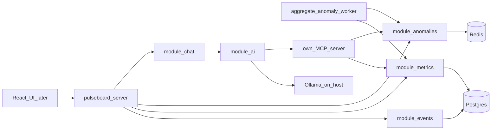

# Architecture overview

**Status: planned**, except the hello entry in `apps/pulseboard-server`. FastAPI and the packages below are the target, recorded in [ADR 0001](../decisions/0001-modular-monolith.md).

## Shape

1. A later React UI calls `pulseboard-server`.
2. The server mounts routes for events, metrics, anomalies, and chat. It does not contain domain rules.
3. `pulseboard-worker` aggregates metrics and runs classical anomaly detection. It does not call a model.
4. `module-chat` streams replies and calls `AiModule`.
5. `module-ai` runs the Investigator graph against Ollama and our MCP server.
6. MCP tools call facades. They return aggregates or a small sample.
7. Postgres holds events, metrics, and incident reports. Redis holds short-lived worker or cache state when a module needs it.

## Libraries

- `pulseboard-core` — ports and settings. No network calls.
- `pulseboard-models` — the only ORM.
- `pulseboard-connectors` — Postgres, Redis, and Ollama.

## Explicitly later

Reporter, Alert triage, the React UI, webhook delivery if it does not fit the anomaly ticket, `ack_alert`, allowlisted SQL, a third-party MCP server, and vector search.
