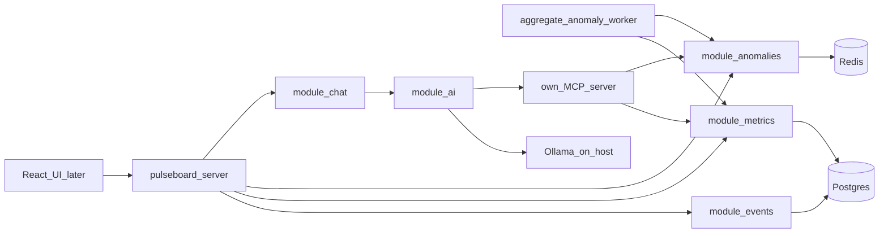

# Pulseboard project plan

This page is the map. It is the copy that stays in git. Feature behavior, once it exists, is a handbook, not a second copy of this page.

Status of the code: uv skeleton (`main.py`, `pyproject.toml`). Domain packages are **planned**.

## Product

Local-first analytics. Events, metrics, and funnels come first. A classical detector flags spikes. An on-prem investigator explains a spike by calling our MCP tools and returning evidence.

Portfolio line: local-first real-time analytics with anomaly detection and an on-prem agentic investigator that uses MCP tools over metrics and funnels (Ollama, zero cloud LLM cost).

What this product is:

- Data is events, metrics, and funnels. Agent memory is a short incident report in Postgres. Vector search is a later bonus.
- The agent reads aggregates the tool returns. The prompt does not receive raw events.
- The LLM is local Ollama. After `ollama pull`, it runs offline.
- The MCP server is ours, over the Pulseboard API. A third-party MCP server may be one extra tool later. It is not the core.
- Three specialized agents, not a general chatbot: Investigator (v1), Reporter (daily summary, SSE), Alert triage (later, noise versus real).

Models: start `qwen2.5:7b` or `llama3.1:8b`. On 8 GB RAM use `qwen2.5:3b` or `phi4-mini`. `qwen2.5:14b` wants 16–32 GB. The agent keeps a short context and one to three tool calls. A GPU is optional.

## Production agents

The pattern matches a production LangGraph agent: a compiled graph that the API calls. LangGraph Studio, if added later, is a local debugger and is not the runtime.

- The Investigator lives in `packages/module-ai`. The entry is `AiModule` only.
- HTTP and SSE live in the chat module and call the facade. Other modules do not import `agents/`.
- The graph runs in the API process (a short tool loop).
- The LLM sits behind `LlmPort` in `pulseboard-core`. The adapter is Ollama on the host (`http://host.docker.internal:11434`). Compose has an `ai` profile: the app and anomalies run without a model. The agent is optional.
- v1 tools are read-only, rate-limited, and non-destructive. `ack_alert` is a later write. `run_safe_sql` is a read-only allowlist.
- Each run logs `ALERT → AGENT_START → tool:… → CONCLUSION + EVIDENCE → AGENT_END` with latency, tools used, and local token counts.

## Architecture

Modular monolith. Thin app shell. One module is one domain. Cross-module calls go through `api.py`.

| Path | Role | Status |
|------|------|--------|
| `apps/pulseboard-server` | FastAPI composition root | planned |
| `apps/pulseboard-worker` | Aggregation and anomaly detection, no LLM | planned |
| `packages/module-events` | Event ingest | planned |
| `packages/module-metrics` | Aggregates, funnels, segments | planned |
| `packages/module-anomalies` | Spikes, alerts, incident reports | planned |
| `packages/module-chat` | Threads and SSE | planned |
| `packages/module-ai` | Investigator now. Reporter and Alert triage later, each its own graph, same `AiModule` | planned |
| `libs/pulseboard-core` | Ports | planned |
| `libs/pulseboard-models` | The only ORM | planned |
| `libs/pulseboard-connectors` | Postgres, Redis, Ollama | planned |
| `mcp/` | Our MCP server. Tools call facades | planned |

Decisions: [ADR 0001](decisions/0001-modular-monolith.md), [ADR 0002](decisions/0002-production-langgraph-agents.md), [ADR 0003](decisions/0003-local-ollama.md).

## Build order

The early app runs with no model. The middle adds anomalies. The AI phase adds tools and the Investigator. Pace is about five hours a week. Dates are not set. Full tickets are written one at a time with `/tasks` into `tasks/`. The ordered list is [first features](how-we-work/first-features.md).

After v1, separate tickets: `list_alerts`, `ack_alert`, `run_safe_sql`, Reporter, React UI, Alert triage, one third-party MCP server as an interoperability check, vector search.

## Repository policy

- Remote, when one is added, is the owner's personal private GitHub account.
- This setup step does not add a remote and does not push.
- Linear is not connected. `/tasks` writes one markdown ticket and stops.

## What this setup step does not do

It does not create the uv workspace, Compose, or domain packages. That work starts when `/tasks` writes ticket 01 and a later chat implements it.
